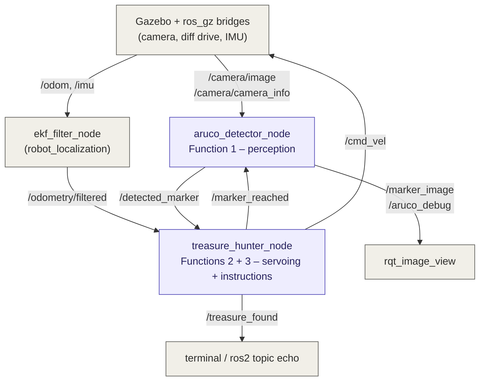
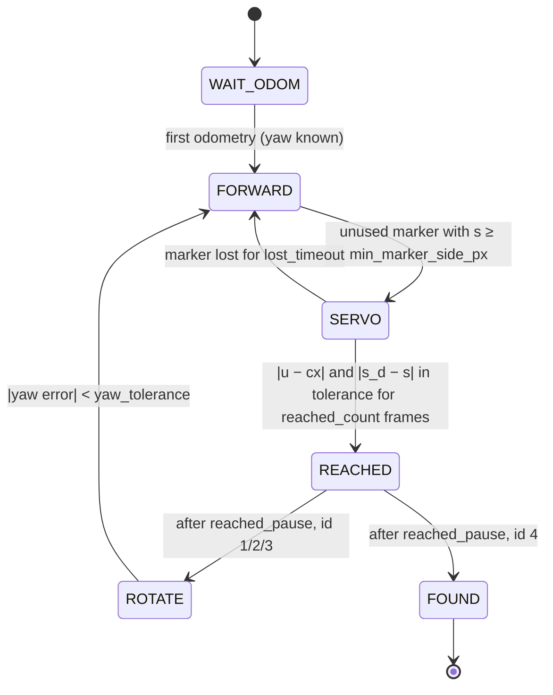

# ERL Assignment 1 – ArUco Treasure Hunt

Experimental Robotics Lab, Università degli Studi di Genova (2026).

A differential-drive robot solves a treasure hunt in **Gazebo** and on the real **ROSbot**.
The world has 4 boxes, each with an ArUco marker (`DICT_ARUCO_ORIGINAL`, 0.2 m). The robot
reaches each marker with **image-based visual servoing**, executes the instruction written in it, and looks
for the next one. Marker 4 ends the hunt.

| Marker | Instruction |
|:-:|---|
| 1 | Turn right by 90°, then go ahead |
| 2 | Rotate by 180°, then go ahead |
| 3 | Turn left by 90°, then go ahead |
| 4 | Stop: treasure found |

## Group

| Name | Student ID |
|---|---|
| Belal Elmikkawy | 8164102 |

## Videos

- Simulation: *link*
- Real ROSbot: *link*

---

## 1. Idea in one paragraph

The robot has **no map**. It only knows what the camera sees now and which way it is facing (yaw).
It repeats one loop: drive straight until an unused marker is visible → drive up to it using only pixel
measurements (centre and apparent size of the marker) → stop when the marker looks 166 px wide and is centred
→ rotate by the angle of that marker, closed loop on the yaw → drive straight again. Every marker is used only
once, so a marker seen again after a rotation is ignored.

## 2. Package structure

```
erl1_assignment1/
├── scripts/
│   ├── aruco_detector_node.py     # Function 1: marker perception
│   └── treasure_hunter_node.py    # Functions 2 + 3: visual servoing, instruction execution, state machine
├── config/
│   ├── assignment_sim.yaml        # parameters for Gazebo
│   ├── assignment_rosbot.yaml     # parameters for the real ROSbot
│   └── ekf.yaml                   # robot_localization EKF (simulation)
├── launch/
│   ├── spawn_assignment.launch.py # Gazebo world + robot + bridges + EKF + RViz
│   ├── world.launch.py            # Gazebo world only (included by the one above)
│   └── hunt.launch.py             # the two assignment nodes, params_file selects sim or ROSbot
├── worlds/assignment.sdf          # the 4 boxes
├── models/aruco_box_1..4/         # box models with the marker textures
├── urdf/                          # robot description + Gazebo plugins (diff drive, camera, IMU)
└── rviz/urdf.rviz
```

## 3. Architecture

### 3.1 Node graph

Purple: nodes written for this assignment. Grey: Gazebo / existing ROS packages.



On the real ROSbot the grey part is replaced by the robot's own drivers (camera, motors, EKF). The two
assignment nodes are unchanged: only the topic names and some gains change, through `assignment_rosbot.yaml`.

### 3.2 Who does what

| Node | Job | Never does |
|---|---|---|
| `aruco_detector_node` | Turns each camera frame into numbers: id, centre and size of every marker. Draws `/marker_image` when told a marker is reached. | Move the robot |
| `treasure_hunter_node` | Decides what to do from the numbers and the yaw, publishes the velocity. | Look at images |
| `ekf_filter_node` | Fuses wheel odometry and IMU into a cleaner pose/yaw. | – |

Splitting perception from control means each node can be tested alone (e.g. the hunter with fake messages
published from the terminal), and the same code runs in simulation and on the robot.

### 3.3 Topics

| Topic | Type | From → To | Content |
|---|---|---|---|
| `/camera/image` | `sensor_msgs/Image` | camera → detector | raw image |
| `/camera/camera_info` | `sensor_msgs/CameraInfo` | camera → detector | intrinsics: `fx = K[0]`, `cx = K[2]` |
| `/detected_marker` | `std_msgs/Float32MultiArray` | detector → hunter | one message per frame, see below |
| `/odometry/filtered` | `nav_msgs/Odometry` | EKF → hunter | yaw of the robot |
| `/cmd_vel` | `geometry_msgs/Twist` | hunter → robot | `linear.x = v`, `angular.z = ω` |
| `/marker_reached` | `std_msgs/Int32` | hunter → detector | id of the marker just reached |
| `/marker_image` | `sensor_msgs/Image` | detector → viewer | frame with circle + id, only when a marker is reached (latched) |
| `/aruco_debug` | `sensor_msgs/Image` | detector → viewer | every frame annotated (debug, off on the ROSbot) |
| `/treasure_found` | `std_msgs/String` | hunter → user | `"Treasure found! (marker 4)"` |

**`/detected_marker` layout**

```
[cx, fx,  id0, u0, v0, s0,  id1, u1, v1, s1, ...]
```

- `cx`, `fx`: principal point x and focal length x (pixels) from `camera_info`
- `id`: marker id; `u, v`: marker centre (pixels); `s`: apparent side of the marker (pixels, mean of the 4 sides)
- A frame without markers is just `[cx, fx]`.

Example: `[320.0, 381.36, 1.0, 300.0, 240.0, 20.0]` → marker 1 is 20 px left of the centre
(u = 300 < cx = 320) and 20 px wide, i.e. about `381.36 · 0.2 / 20 ≈ 3.8 m` away.

## 4. Function 1 – Marker Perception (`aruco_detector_node`)

**Purpose.** Convert the raw camera stream into a compact, per-frame description of every visible marker,
and provide visual evidence each time a marker is reached.

| Interface | Topic | Type |
|---|---|---|
| Input | `image_topic` (`/camera/image`) | `sensor_msgs/Image` |
| Input | `camera_info_topic` (`/camera/camera_info`) | `sensor_msgs/CameraInfo` |
| Input | `marker_reached_topic` (`/marker_reached`) | `std_msgs/Int32` |
| Output | `detection_topic` (`/detected_marker`) | `std_msgs/Float32MultiArray` |
| Output | `marker_image_topic` (`/marker_image`) | `sensor_msgs/Image` (latched) |
| Output | `debug_image_topic` (`/aruco_debug`) | `sensor_msgs/Image` (optional) |

**Processing pipeline (per frame).**

1. **Acquisition** – the ROS image is converted to OpenCV (`cv_bridge`, `bgr8`) and then to grayscale.
2. **Detection** – `cv2.aruco` detects the markers of the configured dictionary (`DICT_ARUCO_ORIGINAL`) and
   returns, for each one, its id and its four corners.
3. **Feature extraction** – for every marker:
   - centre `(u, v)` = mean of the four corners;
   - apparent size `s` = mean length of the four sides (robust to moderate viewing angles).
4. **Publication** – one `/detected_marker` message is published per frame, `[cx, fx, id, u, v, s, ...]`, where
   `cx` and `fx` come from the camera intrinsics (`K[2]`, `K[0]`). An empty frame is published as `[cx, fx]`, so the
   controller can distinguish *no marker visible* from *no data*.
5. **Evidence on demand** – the last frame in which each id was seen is cached. When the controller publishes the id
   on `/marker_reached`, that frame is annotated with a green circle and the label `id N` and published once on
   `/marker_image`, using the drawing prescribed by the assignment:
   ```python
   cv2.circle(img, (cx, cy), r, (0, 255, 0), 3)
   cv2.putText(img, f"id {marker_id}", (cx - r, cy - r - 10), cv2.FONT_HERSHEY_SIMPLEX, 1.0, (0, 255, 0), 2)
   ```

**Design choices.**

- **Separation of concerns:** the node never commands the robot; it only measures.
- **QoS:** camera subscriptions use the sensor-data profile (best effort), compatible with both reliable and
  best-effort camera drivers. `/marker_image` is *transient local*, so a viewer started later still receives the
  last image.
- **Fail-fast configuration:** an unknown dictionary name stops the node at start-up instead of silently detecting
  nothing.
- **Portability:** both the legacy (≤ 4.6) and current (≥ 4.7) OpenCV ArUco APIs are supported, and every topic
  name is a ROS parameter, so the node runs unchanged in simulation and on the ROSbot.

## 5. Function 2 – Image-Based Visual Servoing (`treasure_hunter_node`, state `SERVO`)

**Purpose.** Drive the robot in front of the selected marker, centred and at the prescribed distance, using image
features only. No 3D pose of the marker is estimated.

**Control law.** Two decoupled proportional controllers act on the pixel errors:

| Loop | Law | Behaviour |
|---|---|---|
| Heading (alignment) | `ω = −k_ω (u − cx)` | marker on the right (`u > cx`) → turn right (`ω < 0`) |
| Range (approach) | `v = k_v (s_d − s)` | marker too small (far) → forward; too large (close) → backward |

`s_d` is the desired apparent side of the marker (166 px in simulation, ≈ 0.46 m from the camera).

**Convergence criterion.** The marker is declared *reached* when `|u − cx| < u_tolerance_px` and
`|s_d − s| < s_tolerance_px` hold for `reached_count` consecutive, distinct camera frames. Requiring several new
frames rejects single noisy detections.

**Numeric example** (simulation: `k_ω = 0.004`, `k_v = 0.005`, `s_d = 166 px`, `align_px = 100`):
marker at `u = 400`, `s = 100` →
`u − cx = +80 px` → `ω = −0.32 rad/s` (turn right);
`s_d − s = +66 px` → `v = 0.33 m/s`, scaled by `1 − 80/100 = 0.2` → `v ≈ 0.07 m/s`.

**Robustness extensions** (all configurable):

- **Align, then approach:** `v` is multiplied by `max(0, 1 − |u − cx| / align_px)`, so the robot does not move
  forward while the marker is far from the optical axis and could leave the field of view.
- **Dead-bands** (30 % of the u tolerance, 50 % of the s tolerance) suppress chattering around the set-point.
- **Target selection:** while searching, markers smaller than `min_marker_side_px` (≈ 1.9 m in simulation) are
  ignored, and the largest (closest) unused marker is selected.
- **Measurement loss:** the last measurement is reused for up to `meas_hold_time`; beyond that the robot stops and
  waits, and after `lost_timeout` it returns to searching.
- **Saturation:** every command is limited by `max_linear` / `max_angular` before publication.

**Camera independence (pinhole model).** The apparent size is `s = f · L / d`. To stop at the same distance `d`
with a different camera, the set-point is scaled with the focal lengths:

```
s_d = 166 · fx / fx_sim,     fx_sim = 381.36 px  (640 px wide image, 1.396 rad horizontal FOV)
```

`fx` is read online from `camera_info` (`scale_target_with_fx: true`, `reference_fx: 381.36`), so no manual
retuning of `s_d` is needed on the ROSbot.

## 6. Function 3 – Instruction Execution (states `REACHED`, `ROTATE`, `FOUND`)

**Purpose.** Execute the instruction associated with each reached marker, then resume the search, until the final
marker ends the hunt.

**Instruction table** (parameters `instruction_ids`, `instruction_deltas_deg`, `final_marker_id`):

| Marker | Δ yaw | Action |
|:-:|:-:|---|
| 1 | −90° | turn right, then go ahead |
| 2 | +180° | turn around, then go ahead |
| 3 | +90° | turn left, then go ahead |
| 4 | – | stop, publish `/treasure_found` |

**Execution sequence.**

1. **Acknowledge** – the id is added to the `done` set and published on `/marker_reached` (which triggers
   `/marker_image` in Function 1). The robot holds still for `reached_pause`.
2. **Plan the rotation** – the heading is read from `/odometry/filtered` and the target is computed as
   `target = wrap(yaw + Δ)`. In simulation (`snap_step_deg: 90`) the target is rounded to the nearest multiple of 90°
   from the start heading, removing the residual heading error left by the approach; this is disabled on the
   ROSbot (`0.0`).
3. **Rotate in closed loop** – a saturated proportional controller turns the robot until the error is below
   `yaw_tolerance_deg`:
   ```python
   yaw = math.atan2(2*(q.w*q.z + q.x*q.y), 1 - 2*(q.y**2 + q.z**2))
   err = math.atan2(math.sin(target - yaw), math.cos(target - yaw))      # normalised to [-π, π]
   ω   = sign(err) · clamp(k_rot·|err|, min_rot, max_rot)
   ```
   `min_rot` overcomes static friction near the target; `max_rot` bounds the speed. For the 180° turn, where
   `±π` is ambiguous, the planned direction of rotation is enforced to avoid oscillation.
4. **Resume the search** – the robot goes ahead along the new heading, which is actively held by
   `ω = k_heading · (heading − yaw)`.

**Marker bookkeeping.** Each id is executed exactly once: ids in `done` are ignored for the rest of the run, even
when they re-enter the image (e.g. marker 1 becomes visible again after the 180° turn at marker 2).

**Termination.** When `final_marker_id` is reached, the robot enters `FOUND`, publishes
`"Treasure found! (marker 4)"` on `/treasure_found` and keeps commanding zero velocity.

## 7. State machine (`treasure_hunter_node`)



| State | Robot does | Output |
|---|---|---|
| `WAIT_ODOM` | stands still until the yaw is known | `v = 0, ω = 0` |
| `FORWARD` | drives straight holding its heading, picks the biggest (closest) unused marker | `v = forward_speed` |
| `SERVO` | visual servoing on the locked marker | `v = k_v(s_d − s)`, `ω = −k_ω(u − cx)` |
| `REACHED` | stops, adds the id to `done`, publishes `/marker_reached` (→ `/marker_image`) | `v = 0, ω = 0` |
| `ROTATE` | turns in place to the target yaw | `ω` from the yaw error |
| `FOUND` | stops for ever, publishes `/treasure_found` | `v = 0, ω = 0` |

**Code structure:** callbacks only *store* the latest detections and yaw. A single timer
(`control_loop`, 20 Hz) runs the current state's method (`do_forward`, `do_servo`, …) and is the **only** place
that publishes `/cmd_vel`.

### Expected run in simulation

Boxes at 1 (4, 0), 2 (3, −4), 3 (3, 5), 4 (−1, 4); robot at the origin facing +x:

```
FORWARD → SERVO 1 → REACHED 1 → ROTATE −90°  (yaw −90°)
FORWARD → SERVO 2 → REACHED 2 → ROTATE 180°  (yaw +90°)
FORWARD (marker 1 visible again: ignored) → SERVO 3 → REACHED 3 → ROTATE +90° (yaw 180°)
FORWARD → SERVO 4 → REACHED 4 → FOUND
```

## 8. Installation

Tested on Ubuntu 24.04, ROS 2 Jazzy, Gazebo Harmonic.

```bash
sudo apt install ros-jazzy-ros-gz ros-jazzy-cv-bridge ros-jazzy-robot-localization \
                 ros-jazzy-xacro ros-jazzy-rqt-image-view python3-opencv
# python3-opencv must include the aruco module (OpenCV >= 4.7 or opencv-contrib)

mkdir -p ~/ros2_ws/src && cd ~/ros2_ws/src
git clone git@github.com:Belal-Elmikkawy/erl_assignment1.git erl1_assignment1
cd ~/ros2_ws
colcon build --packages-select erl1_assignment1 --symlink-install
source install/setup.bash
```

The launch file adds `models/` and `~/gazebo_models` to `GZ_SIM_RESOURCE_PATH`. If you keep the boxes in
`~/gazebo_models`, also add to `~/.bashrc`:

```bash
export GZ_SIM_RESOURCE_PATH=$GZ_SIM_RESOURCE_PATH:$HOME/gazebo_models
```

## 9. Running in simulation

Terminal 1 – world, robot, bridges, EKF, RViz:

```bash
ros2 launch erl1_assignment1 spawn_assignment.launch.py          # add rviz:=false to skip RViz
```

Terminal 2 – the two assignment nodes (default: `assignment_sim.yaml`):

```bash
ros2 launch erl1_assignment1 hunt.launch.py
```

Terminal 3 – watch:

```bash
ros2 run rqt_image_view rqt_image_view /marker_image   # one image per reached marker
ros2 topic echo /treasure_found
```

Useful checks:

```bash
ros2 topic echo /detected_marker --field data            # [cx, fx, id, u, v, s, ...]
ros2 run rqt_image_view rqt_image_view /aruco_debug      # live detections
ros2 topic echo /marker_reached
```

## 10. Running on the ROSbot

1. Connect to the lab router and set the domain of your robot
   (rosbot_1 = 10, rosbot_2 = 11, rosbot_3 = 12). Use the default FastDDS, do **not** set `ROS_LOCALHOST_ONLY`.
   ```bash
   export ROS_DOMAIN_ID=10
   ros2 topic list                       # if topics are listed but cannot be echoed: sudo ufw disable
   ```
2. Check that the topic names in `config/assignment_rosbot.yaml` match the robot:
   ```bash
   ros2 topic list | grep -E "camera|odom|cmd_vel"
   ros2 topic echo /camera/color/camera_info --once --field k     # fx = k[0]
   ```
3. Run the nodes with the ROSbot parameters:
   ```bash
   ros2 launch erl1_assignment1 hunt.launch.py \
       params_file:=$(ros2 pkg prefix erl1_assignment1)/share/erl1_assignment1/config/assignment_rosbot.yaml
   ```

Differences from simulation, all in `assignment_rosbot.yaml`: wall clock (`use_sim_time: false`), robot camera
topics, lower gains and speeds, looser tolerances, `reached_count: 3`, `publish_debug: false` (saves Wi-Fi
bandwidth), `snap_step_deg: 0.0`. The stop size `s_d` is rescaled automatically with the ROSbot `fx`.

## 11. Main parameters

| Parameter | Sim | ROSbot | Meaning |
|---|---|---|---|
| `target_side_px` | 166 | 166 (× fx ratio) | desired marker side `s_d` |
| `k_w` / `k_v` | 0.004 / 0.005 | 0.002 / 0.002 | servoing gains |
| `u_tolerance_px` / `s_tolerance_px` | 15 / 6 | 20 / 10 | "reached" tolerances |
| `reached_count` | 2 | 3 | consecutive good frames to declare reached |
| `forward_speed` | 0.4 | 0.15 | m/s while searching |
| `yaw_tolerance_deg` | 2 | 3 | end of a rotation |
| `instruction_ids` / `instruction_deltas_deg` | [1,2,3] / [−90,180,90] | same | marker → rotation (+ = left) |
| `final_marker_id` | 4 | 4 | ends the hunt |

## 12. Stopping everything

`Ctrl+C` in each launch terminal. If Gazebo or RViz stay open:

```bash
pkill -f "gz sim"; pkill -f rviz2; pkill -f parameter_bridge; pkill -f image_bridge
```
